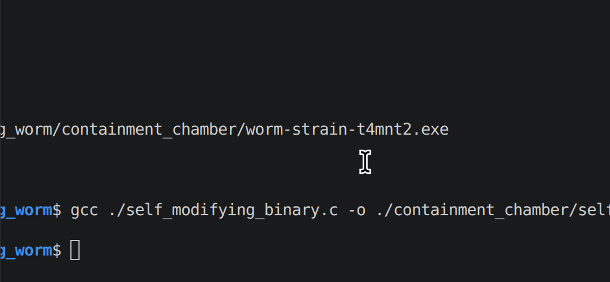

### Welcome to the Worm Terrarium
This is simply a playground for self-replicating programs, so called worms. All worms in this repository are completely harmless and just exist for fun ;)

In fact they aren't really related to malware at all, but rather me having fun with OS syscalls and processes.

### Worm 1 self_modifying_binary.c
So far the only worm in the terrarium is called self_modifying_binary. It is a simple program that reads it's own binary, it then modifies some variables and text, like it's own name and the current iteration of the program. It then stores the updated binary, executes it as a new process and deletes the old binary.

If you are on Linux and maybe Mac (not tested) you can run the binary inside containement_chamber. It takes two arguments (number of evolutions and evolution speed). This is the number of times the program should run and modify itself and the speed this happens at given in milliseconds.

If you don't want to run random executables, you can of course look at the source code and compile it yourself.
gcc ./self_modifying_binary.c -o ./containment_chamber/self_modifying.exe

